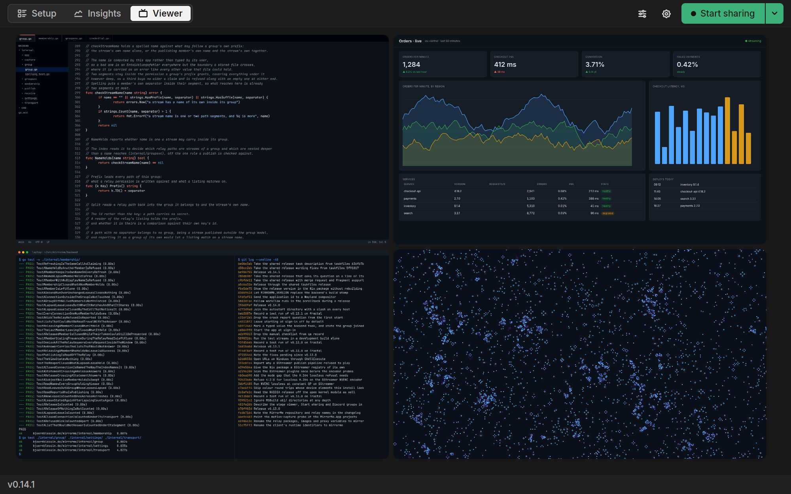
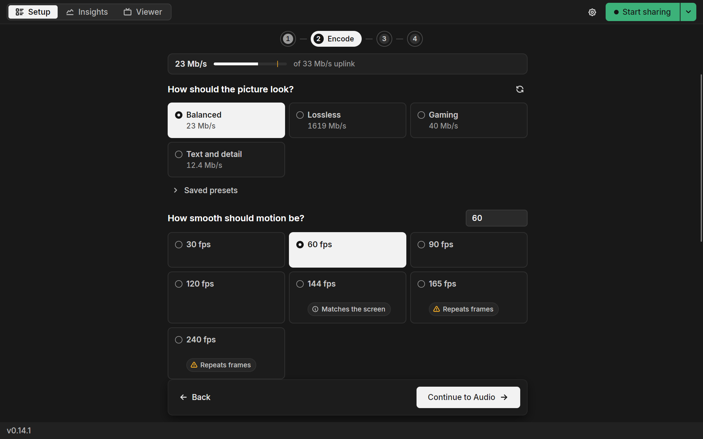

# MirrorMe

Screen sharing for a group, at the quality that the machine can produce.
Everyone shares and everyone watches, at once.
Free and open source, with no accounts.

Built for the screens that a video call blurs: code, a terminal, a spreadsheet, a game at 60 fps.
A call spends two to five megabits a second on a screen and softens everything on it.
MirrorMe spends what your upload carries, up to forty, and leaves the text readable, the thin lines whole and the dark scenes dark.

## What it does

- Everyone in a group shares and watches at the same time.
  One stream plays large, with the others lined up beneath it.
  A press on another stream brings it to the front.
  The Grid switch shows them all side by side.
- Text stays sharp at its own size.
  A terminal or a code editor reads the way it reads on the desk that it came from.
- A tile zooms with the wheel or a pinch, for the one line of small print.
- Four presets name a picture: Balanced, Lossless, Gaming, Text and detail.
  The app works out how this machine reaches the one you pick.
- Setup asks one question at a time: how smooth, how large, how much detail.
  Each answer shows its share of your upload before you pick it.
  A hover over it shows the difference in pictures from real encodes.
- Settings that this machine cannot run are grayed out before you start, each with its reason.
- The graphics card does the encoding wherever it can.
  The processor stays free for the work being shared.
- Desktop sound travels with the picture.
- While you share, the app tells you whether viewers get the picture that you asked for and how far behind each viewer in the app watches.
- A stream is watched in the app, in a browser or in a media player.
- A Discord voice channel can stand in for a group.
  Whoever sits in it can watch.
  Whoever leaves loses the picture within seconds.
  Its streams play in the app alone.

Windows and Linux.

## Install

Downloads are on the [releases page](https://github.com/bjoern621/MirrorMe/releases), one file per platform.
[`docs/install.md`](docs/install.md) covers what each one carries and what a first run asks for.

| Platform | Get it |
| --- | --- |
| Windows | `mirrorme-<version>-windows-x86_64-setup.exe`, or the `.zip` to run from anywhere |
| Arch Linux | `sudo pacman -U mirrorme-<version>-1-x86_64.pkg.tar.zst` |
| Fedora | `sudo dnf install ./mirrorme-*.rpm` |
| Flatpak | `flatpak install --user ./mirrorme-<version>-x86_64.flatpak` |
| Nix | `nix run github:bjoern621/MirrorMe` |
| Other Linux | `mirrorme-<version>-linux-x86_64-portable.tar.gz` |

One window, and no second program to install beside it.

## Share a screen

1. Open MirrorMe and join a group: use your Discord voice channel or paste in the key a member sent.
   The Relay step on the Setup tab creates a new group.
2. Press Start sharing at the top right of the window or pick a preset from the menu beside it.
3. Pick the screen, window or region to share.
4. Watch the others on the Viewer tab.

The Setup tab walks four steps (Capture, Encode, Audio and Relay) for anyone who wants to set the picture by hand.
Insights shows how your own stream holds up and who watches it.

## Who sees it

Streams travel through a relay, one server that the group's members publish to and read from.
Each member uploads one copy however many people watch.
No home connection has to be reachable from outside.
The relay can read what it carries.
A group that wants that ruled out runs one of its own: [`docs/install.md`](docs/install.md), "The relay".
The app comes pointed at the project's relay.

A group comes from a key or from a Discord voice channel.
Anybody holding the key can watch and share.
In a voice channel, sitting in the channel grants the same.
Leaving the channel takes it away.

[`docs/`](docs/README.md) answers the rest: what travels where, what a group is and how the picture is made.

## Developing

Go backend, Avalonia shell, a gRPC contract between them in [`api/`](api/).
`task` lists the development and packaging tasks.
`task all` runs relay, backend and shell together.
[`docs/development-principles.md`](docs/development-principles.md) governs every change.
[`docs/readme-audience.md`](docs/readme-audience.md) governs this page.
`api/`, `backend/`, `avalonia/`, `packaging/`, `deploy/` and `tools/` each carry a README for their own layout.

## License

Apache-2.0 ([`LICENSE`](LICENSE)).
The Windows downloads also carry ffmpeg and the GStreamer runtime, under their own GPL and LGPL terms.
[`THIRD-PARTY-NOTICES.md`](THIRD-PARTY-NOTICES.md) states what every artifact ships and where its source is.
