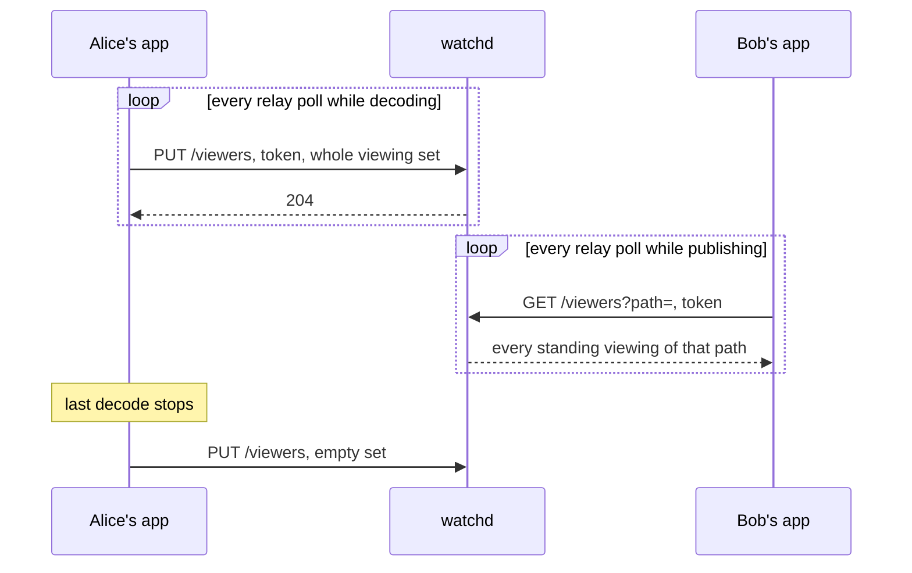

# Viewer reports

This page describes how what each viewer measures of a stream reaches the stream's publisher.
Every viewer's app states to watchd the streams that it decodes, with its own figures for each.
The publisher reads its stream's viewers back and draws a row per member ([insights.md](insights.md), "Screen").
Every leg carries the same figures, since they come off the viewer's decode.

A statement replaces the member's whole set.
A repeat changes nothing.
A statement stands for a lease of several polls.
A viewer who stops stating drops off inside it.

## What a viewer states

| Field | Measured as |
| --- | --- |
| `transport` | the leg it watches over |
| `pathMs` | publisher's encoder to this viewer's decoder, off the clock in each picture ([delay-measurement.md](delay-measurement.md)) |
| `totalMs` | screen to window, a floor where `pathMs` is absent |
| `shownFps` | frames a second reaching the window |
| `droppedFps` | frames a second that the decoder shed to keep up |

An unmeasured figure stays absent.

## Who may state and read

Credential: the relay access token that groupd signs ([auth-flow.md](auth-flow.md)).
watchd verifies it against the key set that groupd publishes and holds no secret.

| Door | Takes | Refused |
| --- | --- | --- |
| `PUT /viewers` | a token whose read grant covers every path that the set names | the whole set, where one path lies outside the group |
| `GET /viewers?path=` | a token whose publish grant covers the path | every member but the stream's publisher |

A member learns who watches their own streams and nobody else's.

## What stays unreported

A viewer in a browser or an external player decodes outside the app and states nothing.
The relay still counts it, so the count over the table can exceed the rows.
Statements live in watchd's memory alone.
A restart loses them until the next poll.
`pathMs` across two machines is worth what their clock synchronization is worth ([delay-measurement.md](delay-measurement.md)).
